```{r setup, include=FALSE}
library(csarGeo)
library(terra)
library(ggplot2)

knitr::opts_chunk$set(
  echo = TRUE,
  fig.width = 7,
  fig.height = 5,
  out.width = "90%",
  fig.align = "left",
  warning = FALSE,
  message = FALSE
)
```

```{css, echo=FALSE}
img {
  max-width: 90%;
  height: auto;
  display: block;
  margin: 0;
}
```

This vignette provides a detailed introduction to the **csarGeo** package. It will familiarize you with the required structure of input data and provide an overview of the workflow for both the `countryside_sar()` and `visuals_sar()` functions. Additionally, it explains the necessary input data structure, specifically the evenness of sampling locations, and its effect on the accuracy of the analysis to ensure optimal utilization.

## Prior To Using The Package

The csarGeo package was developed to provide a short and bundled option for an advanced Species-Area-Relationship (SAR) analysis. It enables the assessment of biodiversity changes in structurally diverse landscapes while accounting for habitat affinity across multiple species groups.

As suggested in previous studies, classic SAR models tend to overestimate species extinction rates due to their inherent assumption of total species-extinction in non-native habitats (Newbold et al., 2015). In contrast countryside SAR (cSAR) models can account for the potential persistence of species in human-modified habitats under different habitat affinities (Martins et al., 2017, Martins et al., 2020). cSAR models therefore offer a powerful analysis tool to assess biodiversity changes.

csarGeo provides an option to perform both a SAR and a cSAR analysis with only one analysis function, `countryside_sar(),` as well as the optional function `visuals_sar()` to create base plots of the results. Using generic input data (s. 1 Input Data), the function transforms, samples, aggregates and analyzes the species-area-relationship.

However, in order to use this package to its full power, users should be aware of potential limitations of the analysis method and the influence of the input data. Per design `countryside_sar()` is most suitable for data sets of intermediate extents with spatially balanced, evenly distributed sampling locations (s. Fig. 1).

- For method "**circles**"

Locally clustered sampling locations, especially in the outer perimeter of the sampling area, may cause an early sampling stop for "circles". Since this method samples from a randomly selected data point outwards, dense clusters increase the probability of repeatedly selecting similar starting locations to begin sampling, causing local overfitting and a reduced ability to generalize the sampled data. Further, this method includes a break-protocol that activates once a defined proportion (50 % by default) of the circular sampling vector lies outside of the sampling area, indicated in red in Fig. 1. If your sampling locations occupy corners of your sampling area very often, the function is likely to stop sampling very early.

- For method "**clusters**"

This method classifies sampling locations into hierarchical groups based on their proximity to one another. Consequently, large spatial distances between sampling locations due to an uneven distribution can cause great jumps of cluster extents from one level to the next. The sampled data may be lacking intermediate spatial scales, making the data less representative of the true habitat mosaic of the landscape at different scales. Without this, the model cannot properly estimate the habitat affinity values of each species group to the habitat types of the landscape.

The full sampling workflow of both "circles" and "clusters" is explained in detail under sections 2.2 and 2.3. A high-resolution land-use raster further increases the accuracy of the pixel-based calculation of the habitat areas and minimizes edge effects around the polygons.

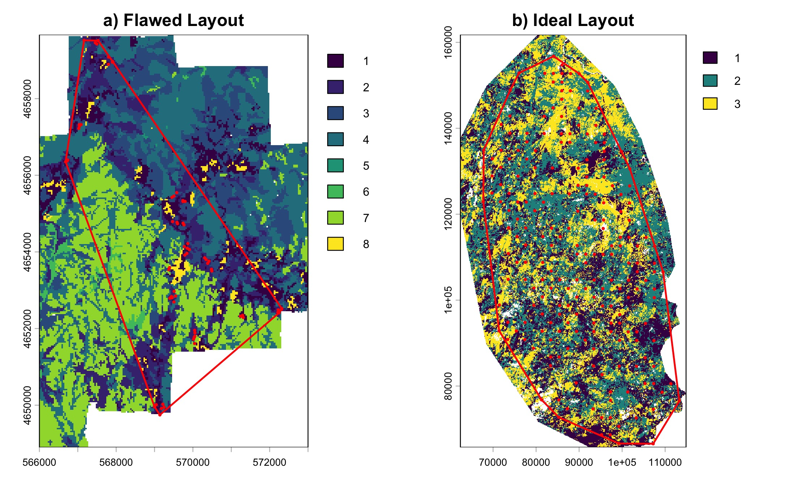

# 1. Input Data

## 1.1 Input Files: Species Data, Raster- and Species Class File

The analysis function `countryside_sar()` requires three distinct input files. Examples of each are included as default datasets in the csarGeo package and can be used to run a sample analysis (see section 5).

1.  **Species Data Table**

- Column 1: sampling location ID

- Columns 2 - 3: longitude and latitude values

- Columns 4 onward: binary presence-absence data for each species (0 = absent, 1 = present)

The function receives this table as the parameter "data".

```{r}
data("species_data")
head(species_data)
```

2.  **Species Classification Table**

- Column 1: species name

- Columns 2 onward: species groups, binary assignment (0 = doesn't belong to group, 1 = belongs to group)

```{r}
data("classes_clusters") 
head(classes_clusters)
```

It is not necessary to mind upper- and lowercase letters for the species names as the function defaults all names to lowercase to account for formatting errors. However, the species names in the classification table and the presence-absence species data table must match.

3.  **Land-Use SpatRaster**

```{r}
land_use <- load_landuse()
plot(land_use)
```

It must contain land-use information for the entire sampling area. Optionally, the user can import a custom polygon hull using the parameter 'custom_hull' for the analysis area of method "circles". Without a user-import, this boundary is auto-generated. It should share the same coordinate reference system (CRS) as the raster file, which should be in an appropriately projected CRS, especially for edge cases like polar or equatorial regions (Kumar et al., 2023).

# 2. Workflow

The countryside_sar() function offers a quite overwhelming choice of possible parameters. To help the user along, this section aims to familiarize them with the general workflow of the function and explain the difference between the two main analysis pathways "circles" and "clusters". Examples of calls for both pathways are provided in section 5.

## 2.1 General Workflow

To begin, and regardless of the method of choice, the function combines the latitude and longitude column data into one coordinate column for each location. To assure proper transformation, make sure you are aware of the projection of the latitude and longitude of your data as per section 1.

It then continues with one of two possible analysis pathways: either "circles" or "clusters". Method "circles" samples data-points in expanding circles within a polygon hull, beginning with a randomly selected sampling point. "Clusters" executes a step-wise proximity based grouping of sampling locations from singular sampling units up to the entire sampling area. While the method differs, both sample species data and locations, which are then used to aggregate species occurrence data as well as habitat and total area in a results table.

As its last step countryside_sar() executes a SAR analysis by fitting the aggregated species and area data of either method with a simple log-log scaled linear power model and, in case of "clusters", a countryside SAR analysis as well. This cSAR analysis provides information about the habitat affinity of each species group to each habitat of the raster.

## 2.2 Method: Circles

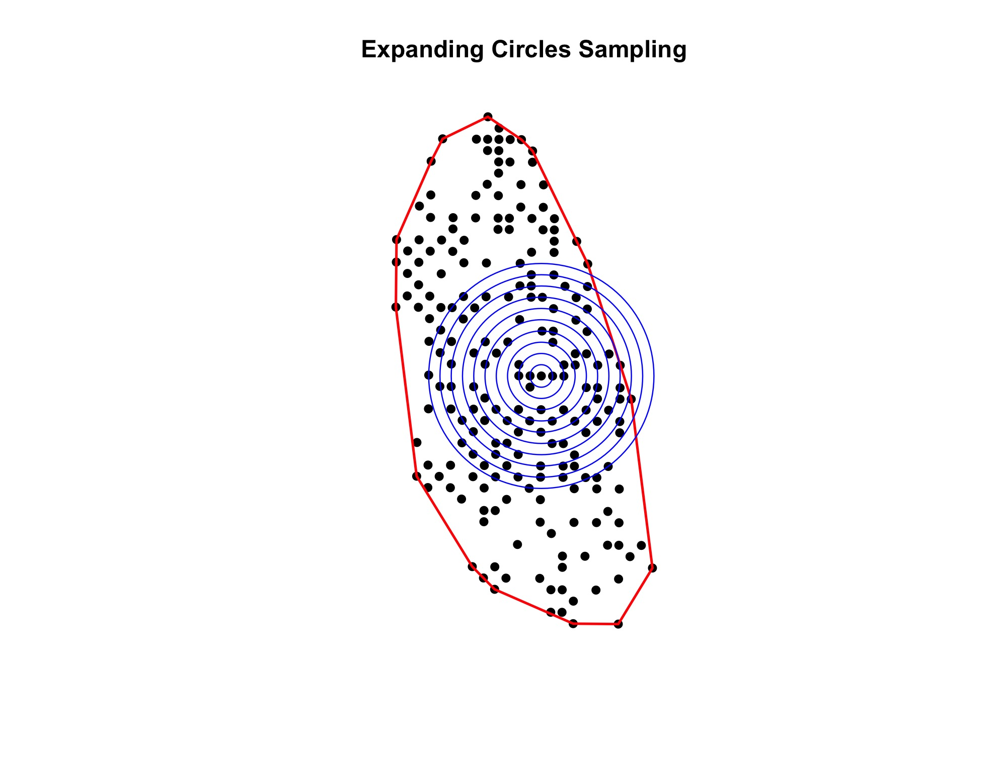{width="585"}

The **expanding circles sampling** is one of two possible sampling methods of the function `countryside_sar()`, most suited for a classic SAR analysis. Prior to sampling, the function wraps a hull around all sampling locations, indicated in red in figure 3. The function may use a hull imported via the `custom_hull` parameter, or it will auto-generate one. Then one of the sampling locations within the hull is chosen randomly as the first sampling point. In step-wise expanding circles, the function then samples species, habitat, and coordinate data for every defined radius and then aggregates for each circle: the area of each habitat, the total area, the species richness of each species group, the total species richness and the total polygon area.

The properties of the expanding sampling circles are defined by the parameter `radius`. It defines both the amount of circles used to sample data via the vector length as well as the distance between the circles.

The function stops sampling by default if more than 50 % of the area of a circular vector lie outside of the hull boundary. If needed, this can be adjusted using the parameter `break_threshold` ranging from 0 (function continues regardless of how much of the circle lies outside of the hull) to 1 (the function breaks off immediately if any part of the circle lies outside the hull).

A full analysis example is provided in 5.1.

To use the first pathway, "circles", the user may choose from the following parameters:

| Parameter | Description | Necessary |
|------------------------|------------------------|------------------------|
| data | binary species data and sampling location latitude and longitude | Non-optional |
| method | defines "circles" as sampling method | Non-optional |
| radius | Defines the radius size as well as the total amount of circles for method: "Circles" | Non-optional |
| habitat | Land-use raster .tif of the sampling location | Non-optional |
| habitat_names | Character vector with the names of the land-use types of the land-use raster defined in 'habitat'. | Non-optional |
| classification | Species classification file. A table with a first column for species names and the following columns as binary (0/1) group indicators. | Non-optional |
| n_runs | Number of iterations, default n_runs = 1 | Non-optional |
| break_threshold | Initiates break-protocol for method "Circles" based on the proportion of the circular vector that lies inside the convex hull. E.g. break_threshold = 0.9 -\> if less than 90 % of the circle lies inside of the hull, stop. Defaults to 0.5 | Optional |
| custom_hull | Import a polygon hull for method "circles". If method = "clusters" the function will ignore the imported hull and auto-generate a hull instead. If custom_hull = NULL, the function auto-generates a hull for method "circles". | Optional |
| groups | Species groups to use for analysis, defaults to NULL, the function will use all groups available in classification file | Optional |
| seed | Optional seed for reproducibility | Optional |

## 2.3 Method: Clusters

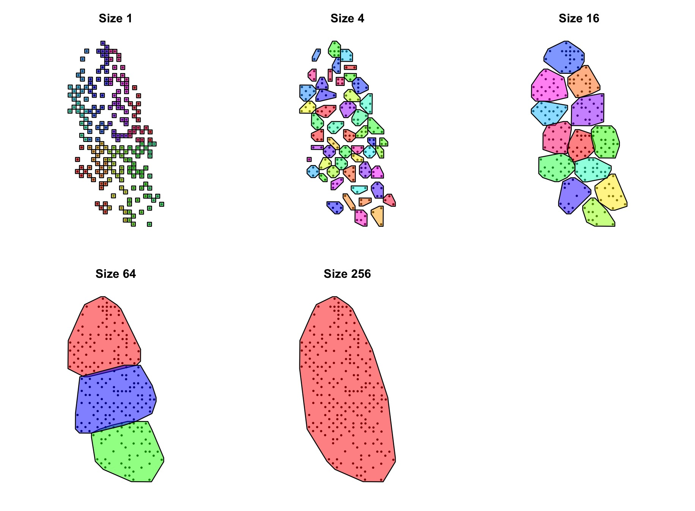

In contrast to "circles", the analysis of "clusters" is deterministic: it always begins with every individual sampling location as a cluster unit and ends with one final cluster that includes all sampling locations. It is most useful for a cSAR analysis, but it also provides a SAR analysis option as well. However, the step wise increase of area is determined by the distribution of sampling points in the landscape and thus more prone to uneven increases of areas in between levels compared to the evenly spaced sampling circles of method "circles". As a result, the model fit of the classic SAR for method "clusters" is typically lower than for method "circles" on the same dataset.

The clustering of samples is proximity-based and, as for method "circles", saves habitat, species occurrence data of the sampling locations within each cluster, as well as geometry data of the polygon around the cluster. It is not possible to import hulls in the same manner as for "circles", every polygon is auto-generated.

Each level of the clusters method aggregates sampling locations and their species data for each cluster. The first level assigns a group to each sampling location (every location is its own cluster), the last group includes all locations in one cluster.

For this analysis pathway, `countryside_SAR()` requires the following parameters:

| Parameter | Description | Necessary |
|------------------------|------------------------|------------------------|
| data | binary species data and sampling location latitude and longitude | Non-optional |
| method | defines "clusters" as sampling method | Non-optional |
| square_size | The size of the square buffer for each sampling point for method "Clusters". | Non-optional |
| cluster_sizes | Numerical vector that defines the amount of levels for the hierarchical "Clusters" approach as well as the amount of clusters within each level, e.g. c(1, 4, 16, 64, 256) -\> 5 levels, first level 256 clusters, second level 64 clusters, etc. | Non-optional |
| habitat | Land-use raster of the sampling location, a .tif file. | Non-optional |
| habitat_names | Character vector with the names of the land-use types of the land-use raster defined in 'habitat'. | Non-optional |
| classification | Species classification file. A table with a first column for species names and the following columns as binary (0/1) group indicators. | Non-optional |
| groups | Which group columns to use from classification (NULL = use all columns except first). Defaults to NULL. | Optional |

## 2.4 Classic SAR and cSAR Analysis

Despite its name, the `countryside_sar()` function offers two possible models for the sampled species data: a **classic SAR analysis** and a **countryside SAR analysis (cSAR)**, both of which use the sars package as well as the aggregated data from either the circles or the clusters pathway. While the classic SAR is available for both analysis pathways, the cSAR analysis is only possible using method 'clusters'.

Due to its nested design, "circles" produces sampling data with high spatial autocorrelation. Further, the step-wise increase of the sampling circles produce a table with varying spatial data, but offers no way to differentiate the habitat quality of the sampled area in a general context. By running "circles" multiple times, it is possible to produce a usable SAR analysis via the average of all individual SAR results, but due to the overlap between the runs, multiple runs cannot be used in the same manner as multiple hierarchical levels of method 'clusters' to run a cSAR analysis. The latter allows for the discrimination of habitat quality alongside spatial variance: the cSAR analysis does not simply compare the species richness of each cluster within each level, it also compares the habitat mosaics of all the clusters within a hierarchical level to assess the habitat affinity of each species group to the available habitats. In contrast, the classic SAR only projects the species richness depending on the total area available and only discriminates between a fully suitable habitat where a species can occur, and a fully unsuitable habitat where a species can't occur. The habitat qualities do not matter in this analysis.

For the classic SAR analysis and based on the species-area-relationship model of

$$S = c * A^z$$\$\$S = c \* A\^z\$\$\$\$S = c \* A\^z\$\$

where *S* is species richness, *A* is the sampled area, *z* is the species accumulation rate (slope), and *c* is the species richness at unit area (intercept). The function fits a log-log scaled standard linear regression model to the sampled species data, which is defined as:

$$log(S) = log(c) + z * log(A)$$

This classic model approach assumes that all habitat types contribute equally to species richness, effectively treating the landscape as homogeneous.

The cSAR model extends the classic SAR formula by replacing the total area A with a habitat-weighted area sum using

$$S_i(A_1, A_2, \ldots, A_n) = c_i \left( \sum_{j=1}^{n} h_{ij} A_j \right)^z$$

where *n* is the number of habitat types,*h~ij~* is the affinity of the species group *i* to habitat *j*, *A~j~* the area of habitat *j*, and *c~i~* measures the relative local abundance of each species group *i* (Martins and Pereira, 2017). As with the classic SAR, S is the species richness of the group and z the species accumulation rate (slope).

The cSAR analysis then fits the following non-linear regression model to the sampled data of each species group for each habitat to determine the affinities of all species groups to all available habitats.

$$S \sim (h_1 \times A_1 + h_2 \times A_2 + h_3 \times A_3)^z$$

# 3. Output

The output of an analysis using "circles" is almost identical to the 'clusters' analysis. Both are large lists containing information about the method used, a **results table**, which holds the aggregated species and area data (per habitat and group as well as total sum) for either each circle or each cluster, the **results of the standard SAR and cSAR analysis** with the corresponding model data, a list with the **samples** of each sampling occurrence, both binary species data for each level as well as the polygon used to sample the data of this particular level (either a circle or the polygon around a cluster) and a list with the **sf transformed input species data** (points_sf for "circles" and squares_sf for "clusters") with the added coordinate column of each sampling location (s. 2.1 General Workflow). As for "circles" the output includes information about the polygon hull that defines the sampling area within **convex_hull**, "clusters" on the other hand holds information about the polygon around the clusters of each level in **clusters_chulls**.

To manually inspect both results table structures, please consult the provided examples in 5.

## 3.1 Circles

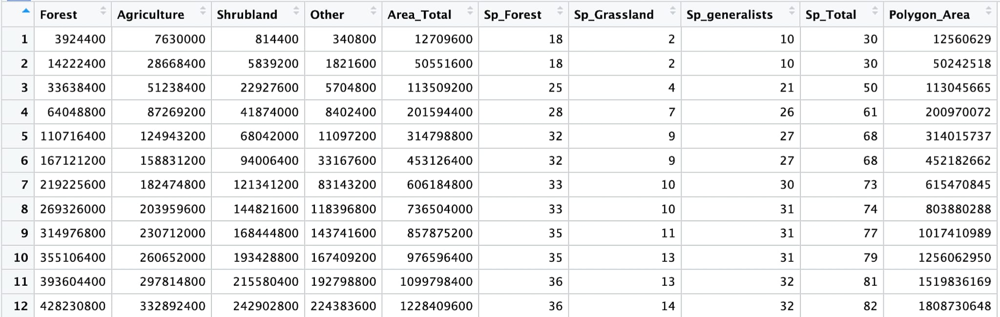{width="636"}

## 3.2 Clusters

The output of method 'clusters' is not nested as it can only contain the results of a single run. Outside of that, the general structure is the same as the output of "circles".

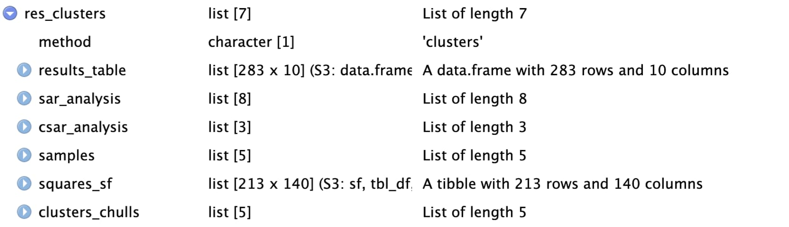{width="499"}

The results_table contains the aggregated species data. Note that the rows are continuous; all clustering levels follow one another without interruption.

Aside from the columns for the area of each habitat type, two columns relate to areas: Area_Total, which is the aggregated sum of the calculated area and Polygon_Area, which is the area of the polygon defining the boundary of a cluster. Ideally, the values in these columns should be very similar. Use this as a control to make sure the function doesn't over- or underestimate the habitat areas.

# 4. Visualization using visuals_sar

The `visuals_sar()` function does not add any further analysis and only serves as a quick way to plot the results of the `countryside_sar()` function. As such it only includes the absolute minimum of possible plot modifications of both a map for the sampling layout as well as the results of the SAR analysis. The user can, of course, always plot these results using their own methods.

In total, the function can generate 6 different plots:

- **`map`**: Map of the sampling layout, showing either the sampling circles over the points within the polygon hull boundary, or the level-wise clusters

- **`sar`**: log-log scaled scatterplot of the classic species-area relationship

- **`csar`**: log-log scaled scatterplot of the effective habitat area against observed species richness per species group

- **`affinities`**: Heatmap displaying the affinity of each species group to each habitat type

- **`habitat_proportion`**: Line plots showing the effect of changing the proportion of a specific habitat on species richness per group

- **`fit`**: Scatterplot of predicted vs. observed total species richness to assess model fit

`visuals_sar()` requires the following parameters:

| Parameter | Description | Method |
|------------------|-------------------------------------|------------------|
| result | Output from `countryside_sar()` | Both |
| plot_type = "map" | Map of sampling locations, either with sampling circles or clusters | Both |
| plot_type = "sar" | Scatterplot of the species-area-relationship (SAR); log-log scaled | Both |
| plot_type = "csar" | Scatterplot of the countryside species-area relationship (cSAR) with effective area; log-log, faceted by species group; equivalent to `sars` type 4 plot of `plot.habitat()` | Clusters |
| plot_type = "affinities" | Heatmap of habitat affinities across species groups | Clusters |
| plot_type = "fit" | Scatterplot of predicted vs. observed total species richness; equivalent to `sars` type 1 plot of `plot.habitat()` | Clusters |
| plot_type = "habitat_proportion" | Line plot of predicted species richness along a habitat proportion gradient; equivalent to `sars` type 3 plot of `plot.habitat()` | Clusters |
| plot_all_runs | Plot all iterations into one grid, defaults to TRUE; belongs to `plot_type = "map"` | Circles |
| plot_run_n | Plot only one specific iteration, defaults to NULL; belongs to `plot_type = "map"` | Circles |
| plot_all_levels | Plot all hierarchical levels into one grid, defaults to TRUE; belongs to `plot_type = "map"` | Clusters |
| plot_level_n | Plot only one specific level, defaults to NULL; belongs to `plot_type = "map"` | Clusters |
| focal_habitat | The habitat whose proportion is varied on the x-axis, defaults to NULL (plots all habitats); belongs to `plot_type = "habitat_proportion"` | Clusters |
| total_area | The fixed total area at which habitat proportions are varied, defaults to the maximum observed area; belongs to `plot_type = "habitat_proportion"` | Clusters |

## 4.1 Circles Visualization

The results of method "circles" may be plotted in two different ways: a **map plot** of the sampling and a **scatterplot** of the species-area-relationship.

### 4.1.1 Map Plot

Using

```{r}
# visuals_sar(res_ci, plot_type = "map")
```

creates a map of each individual individual run of method "circles" with the corresponding run number. It allows for a quick visual check of sampling success: here, 5 out of 6 runs could sample to the full extent, run 4 initiated the break protocol early on, likely due to sampling locations near the hull boundary.

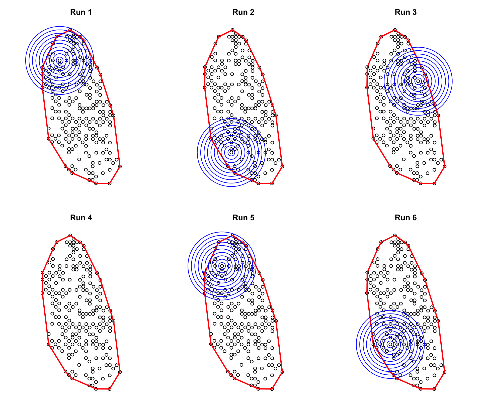{width="632"}

To plot only one specific run, in the example run number 3, use the parameter `plot_run_n = 3:`

```{r}
# visuals_sar(res_ci, plot_type = "map", plot_run_n = 3)
```

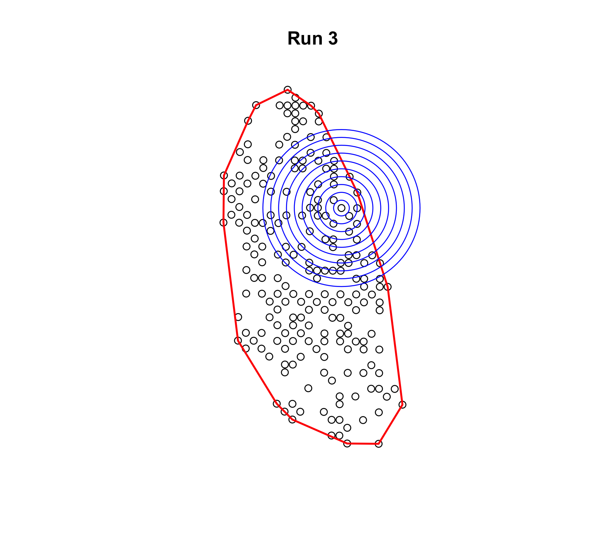{width="468"}

### 4.1.2 SAR Scatterplot

`visuals_sar()` offers three different ways to plot the results of the classic SAR model: either the plots of each individual run, single or displayed in a grid, or the averaged SAR result across all valid runs. If a run did not contain a sufficient amount of samples for the SAR model, the corresponding run is marked as invalid in the grid of individual run plots.

The legend displays the fitted regression equation, the scaling exponent (z), and the model fit.

```{r}
# visuals_sar(res_ci, plot_type = "sar")
```

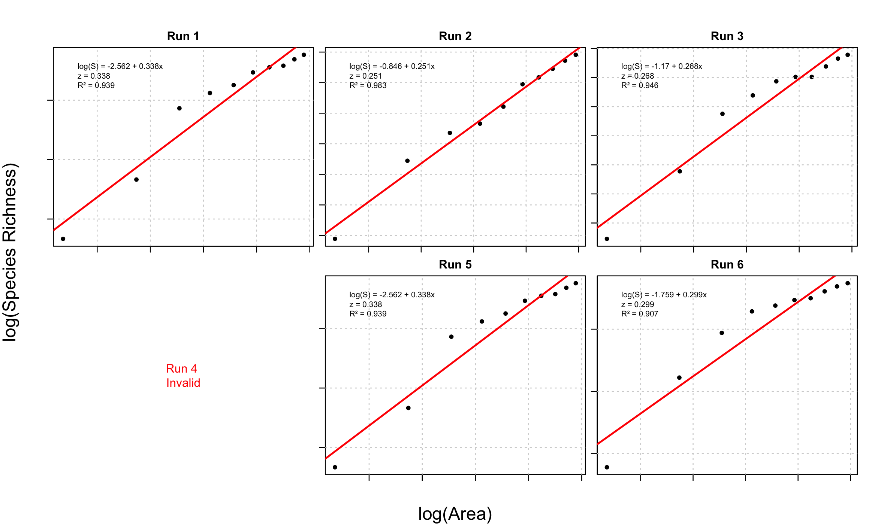

For the SAR result of a specific run, use the parameter `plot_run_n`:

```{r}
# visuals_sar(res_ci, plot_type = "sar", plot_run_n = 2)
```

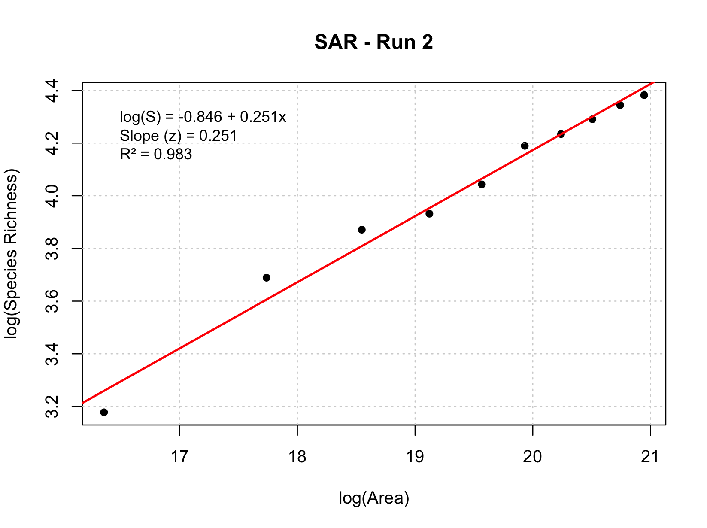{width="509"}

The final plot option is the average SAR result of all "circles" runs of a single call. It contains the fitted regression equation, the mean scaling exponent, the average model fit and the number of runs used to calculate the values.

```{r}
# visuals_sar(res_ci, plot_type = "sar", plot_average = TRUE)
```

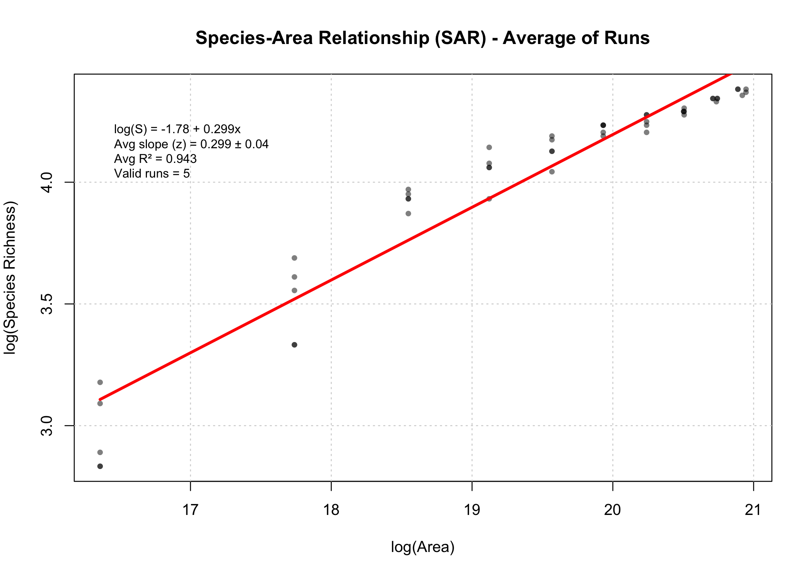

## 4.2 Clusters

### 4.2.1 Map Plot

Similar to "circles", the map of a "clusters" result can display either all levels of sampling clusters in a single grid using

```{r}
# visuals_sar(res_cl, plot_type = "map")
```


Or a map of a specific level, in this example level 4, which corresponds to size 64:

```{r}
# visuals_sar(res_cl, plot_type = "map", plot_level_n = 64)
```

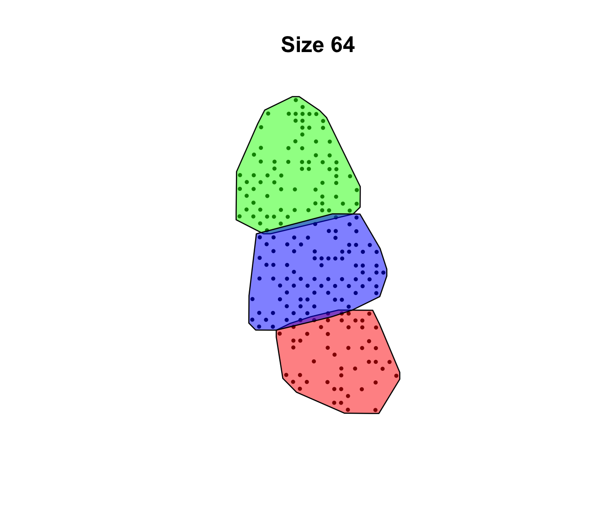{width="489"}

### 4.2.2 SAR Plot

To produce a classic SAR scatterplot for the "clusters" method, use:

```{r}
# visuals_sar(res_cl, plot_type = "sar")
```

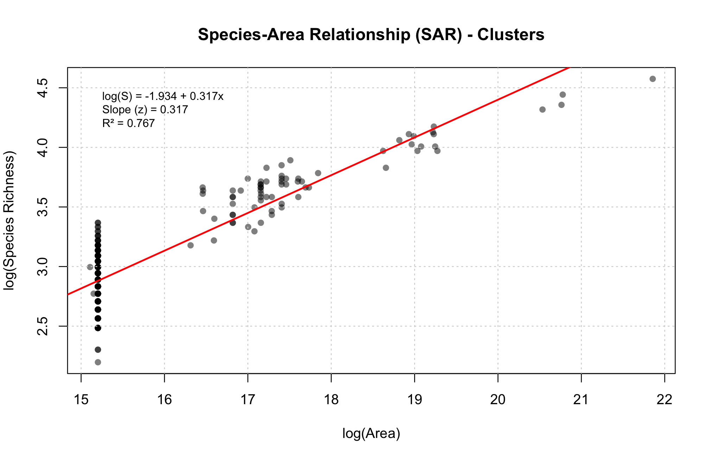

It displays the log-log relationship between the total area of the clusters (x-axis) and the total observed species richness within those clusters (y-axis). Each point corresponds to a single cluster at a given level, with the distinct 'clouds' of points representing the stepwise increase in cluster area across levels. The red line indicates the fitted linear regression with the resulting regression equation, scaling exponent and model fit provided in the legend.

### 4.2.3 cSAR Plot

In total `visuals_sar()` offers four ways to visualize the cSAR results of method "clusters":

- **Affinity Heatmap**: Displays the affinities of the species groups to the different habitat types, 1 being a perfect habitat, 0 meaning no affinity towards the habitat type at all and intermediate values indicating different degrees of habitat utilization.

```{r}
# visuals_sar(res_cl, plot_type = "affinities")
```

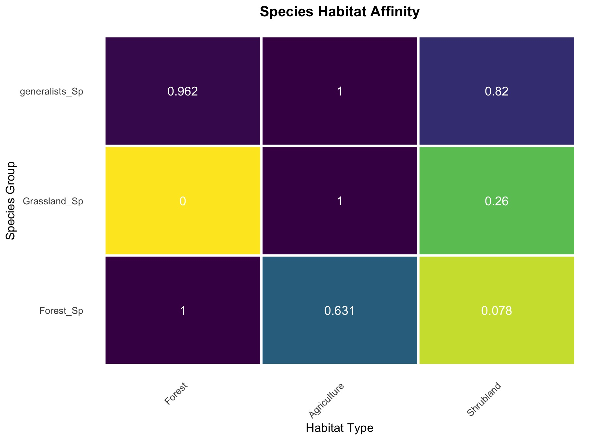

- **Effective Area**: Shows the log-log relationship between the effective area (the sum of habitat areas weighted by their affinity) and observed species richness for each species group, faceted by group. Points represent individual sampled landscapes, and the red line indicates the fitted power-law regression. The legend reports the model fit and the scaling exponent with its standard error. It is based on the type 4 plot of `plot.habitat()` of the `sars` package (v2.1.1, Matthews et al., 2019).

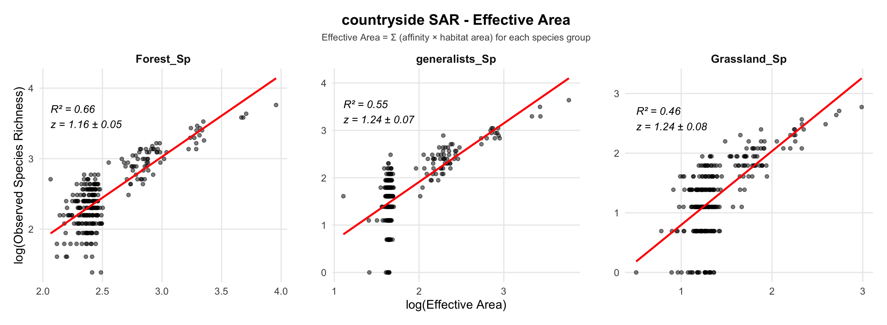

- **Model Fit:** A predicted vs. observed scatterplot of total species richness. Each point is a sampled landscape, placed by its cSAR-predicted richness (x-axis) against its observed richness (y-axis). A dashed red 1:1 line serves as the reference for perfect prediction. The legend reports the model fit, RMSE, and the slope of the observed vs. predicted relationship to assess model accuracy and calibration. Based on the type 1 plot of `plot.habitat()` of the `sars` package (v2.1.1, Matthews et al., 2019).

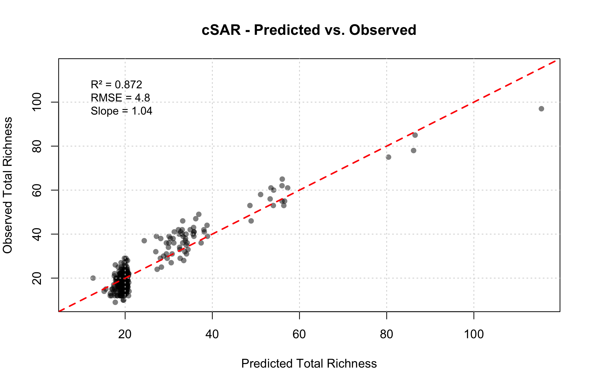{width="553"}

- **Habitat Proportion:** Line plots showing how predicted species richness for each group responds as the proportion of a focal habitat is varied from 0 to 1, holding total area constant (fixed at the largest observed site). One panel is shown per habitat, with all species groups drawn as separate lines. When `focal_habitat` is set, only that habitat's panel is plotted. Based on the type 3 plot of `plot.habitat()` of the `sars` package (v2.1.1, Matthews et al., 2019).

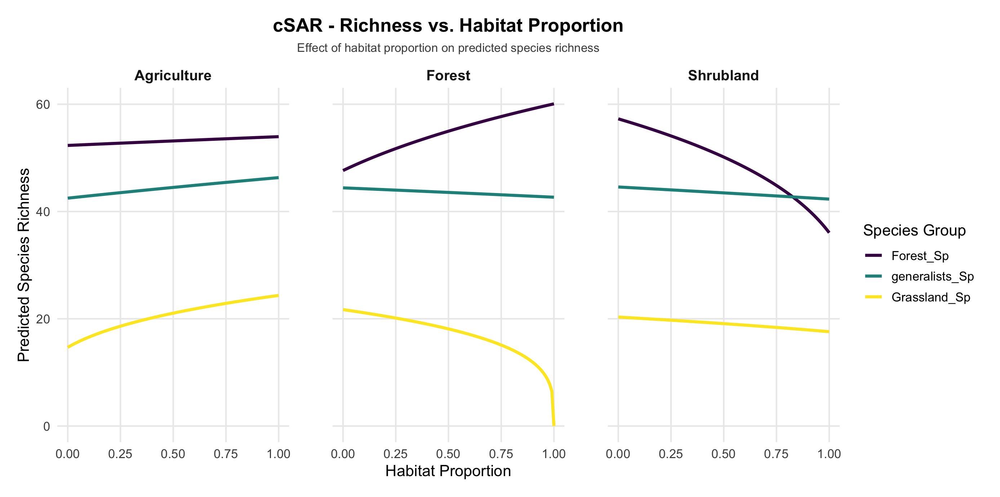

# 5. Examples: Full Analysis

To familiarize you with the workflow of csarGeo, this section contains a full example analysis for either sampling method with all possible visualization options.

The csarGeo package contains three files that may be used to run the analysis examples of 5.1 and 5.2., all of which are loaded at the beginning of both example analyses.

## 5.1 Circles

```{r}
# Load all example data files
data("species_data")
data("classes_clusters")
land_use <- load_landuse()

# Circles analysis using countryside_sar
# create 10 sampling circles of 2000 spatial units (here m) distance
res_ci <- countryside_sar(
  data = species_data,
  method = "circles",
  radius = 2000 * 1:10,
  habitat = land_use,
  habitat_names = c("Forest", "Agriculture", "Shrubland"),
  classification = classes_clusters,
  groups = c("Forest_Sp", "Grassland_Sp", "generalists_Sp"),
  n_runs = 6
)

# Visualization using visuals_sar
# Map plot
visuals_sar(res_ci, plot_type = "map")
visuals_sar(res_ci, plot_type = "map", plot_run_n = 2)

# SAR
visuals_sar(res_ci, plot_type = "sar")
visuals_sar(res_ci, plot_type = "sar", plot_average = TRUE)
```

## 5.2 Clusters

```{r}
# Load all example data files
data("species_data")
data("classes_clusters")
land_use <- load_landuse()

# Clusters analysis using countryside_sar
res_cl <- countryside_sar(
  data = species_data,
  method = "clusters",
  square_size = 2000,
  cluster_sizes = c(1, 4, 16, 64, 256),
  habitat = land_use,
  habitat_names = c("Forest", "Agriculture", "Shrubland"),
  classification = classes_clusters,
  groups = c("Forest_Sp", "Grassland_Sp", "generalists_Sp")
)

# Visualization using visuals_sar
# Map plot
visuals_sar(res_cl, plot_type = "map")
visuals_sar(res_cl, plot_type = "map", plot_level_n = 64)

# SAR
visuals_sar(res_cl, plot_type = "sar")

# cSAR - effective area
visuals_sar(res_cl, plot_type = "csar")

# csar habitat affinities
visuals_sar(res_cl, plot_type = "affinities")

# csar model fit
visuals_sar(res_cl, plot_type = "fit")

# habitat proportion
visuals_sar(res_cl, plot_type = "habitat_proportion")
visuals_sar(res_cl, plot_type = "habitat_proportion", focal_habitat = "Agriculture")
```

# 6. References

Kumar, M., Singh, R.B., Singh, A., Pravesh, R., Majid, S.I., Tiwari, A. (2023). Referencing and Coordinate Systems in GIS. In: Geographic Information Systems in Urban Planning and Management. Advances in Geographical and Environmental Sciences. Springer, Singapore. <https://doi.org/10.1007/978-981-19-7855-5_2>

Matthews, T.J., Triantis, K., Whittaker, R.J. and Guilhaumon, F. (2019) sars: an R package for fitting, evaluating and comparing species–area relationship models. Ecography, 42, 1446-1455.

Matthews, T. J., and F. Rigal. 2021. Thresholds and the species–area relationship: a set of functions for fitting, evaluating and plotting a range of commonly used piecewise models in R. Frontiers of Biogeography, 13, e49404.

Martins, I., Pereira, H.M. Improving extinction projections across scales and habitats using the countryside species-area relationship. *Sci Rep* **7**, 12899 (2017). <https://doi.org/10.1038/s41598-017-13059-y>

Inês S. Martins u. a., „Alternative pathways to a sustainable future lead to contrasting biodiversity responses“, Global Ecology and Conservation 22 (Juni 2020): e01028, <https://doi.org/10.1016/j.gecco.2020.e01028>.

Newbold, T., Hudson, L., Hill, S. et al. Global effects of land use on local terrestrial biodiversity. Nature 520, 45–50(2015). <https://doi.org/10.1038/nature14324>
